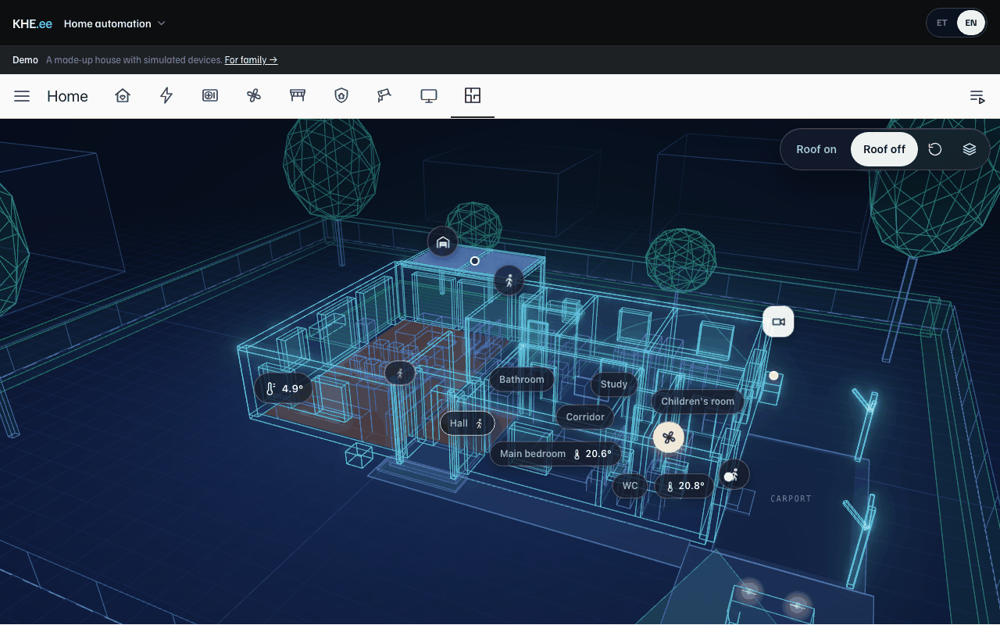

# khe-house3d

[](https://github.com/khelias/khe-house3d/actions/workflows/ci.yml)

A 3D view of a house drawn from its measured plan, for anyone who wants to
see a house and its devices in place in the browser: walls, openings, roofs,
rooms, furniture and the lot, kept as a small parametric model in Markdown
and drawn with [three.js](https://threejs.org/). It runs inside the Home
Assistant demo at [khe.ee/ha](https://khe.ee/ha/), on a made-up house.

[](https://khe.ee/ha/)

## How it works

The view has three styles: a neon wireframe, a lit one with the sun where it
stands at that hour, and a photographic one with a textured lawn and sky and
leafy trees. The roofs lift off to show the rooms, and a house of more storeys,
an attic or a basement shows each storey from inside. The house's own look, its
colours, cladding and trims, is part of its model; without one the view
draws a plain architectural model.

This repo holds the engine, the model format and its validator, the
standalone viewer build, three made-up test houses and the made-up house the
[khe.ee/ha](https://khe.ee/ha/) demo shows. The Home Assistant card
that shows our own house with its devices lives in
[khe-home-assistant](https://github.com/khelias/khe-home-assistant), which
carries a pinned copy of this engine.

## Run it

You need Python 3 and Node.js.

```bash
bash scripts/check.sh
python3 -I scripts/house3d_viewer.py tests/house3d/fixture-twostorey.md /tmp/house
python3 -m http.server 8000 --directory /tmp/house
```

The first runs every test. The second builds the viewer for a test house,
which the third serves at <http://localhost:8000>.

## More

- [AGENTS.md](AGENTS.md) - layout, commands and rules for working on the engine
- [docs/decisions/](docs/decisions/) - this repo's decisions, first why it
  has an engine of its own

## Licence

MIT, see [LICENSE](LICENSE). three.js, vendored under `house3d/vendor/`, is
under its own MIT licence.
